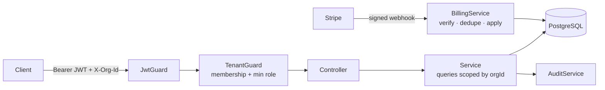

# Multi-tenant SaaS Starter

**A production-ready backend foundation for B2B SaaS: organizations, role-based access control, invitations, plan limits, Stripe subscriptions and an audit log.** Built with NestJS, Prisma and PostgreSQL.


Every B2B product needs the same unglamorous groundwork before the first real feature ships. This starter implements it carefully, with the edge cases covered by tests.

## Features

| Area | What's included |
|---|---|
| **Tenancy** | Users belong to many organizations. The active org comes from the `X-Org-Id` header and is **verified against membership** on every request. All queries are scoped by the verified org id, never by client input. |
| **RBAC** | `OWNER` › `ADMIN` › `MEMBER` hierarchy with a `@RequireRole()` decorator. Admins can only manage roles below their own, and an org can never lose its last owner. |
| **Invitations** | Single-use, 7-day tokens. Only a **SHA-256 hash** is stored; invites are bound to the invitee's email. |
| **Plans & limits** | `FREE` and `PRO` plans with member/project limits, enforced server-side with a machine-readable `PLAN_LIMIT_REACHED` error the UI can turn into an upgrade prompt. |
| **Billing** | Stripe Checkout and Customer Portal. Webhooks are **signature-verified** using the raw body and **idempotent** (processed event ids are stored), so Stripe retries are safe. |
| **Audit log** | Append-only record of who did what: invites, role changes, removals, subscription changes. Auditing failures never break the business action. |
| **API quality** | Request validation, rate limiting on auth, Swagger docs at `/docs`, consistent error shapes. |

## Architecture



### Request flow for a tenant route

1. `JwtGuard` authenticates the user.
2. `TenantGuard` reads `X-Org-Id`, loads the membership for *(user, org)*, and rejects with `403` if there is none. It returns the same error whether the org doesn't exist or you're not a member, so org ids can't be probed.
3. If the route has `@RequireRole('ADMIN')`, the member's role is checked against the hierarchy.
4. The handler receives a `TenantContext { organizationId, role }` via `@Tenant()`, and services use **only** that `organizationId` in their `where` clauses.

Adding a new tenant-owned resource means copying the pattern in `src/projects/`.

## Quick start

```bash
cp .env.example .env
docker compose up -d postgres
npm install
npx prisma db push
npm run start:dev
```

Open http://localhost:4000/docs for the interactive API.

### Try it

```bash
# Register and create an organization
TOKEN=$(curl -s localhost:4000/api/auth/register -H 'content-type: application/json' \
  -d '{"email":"anna@acme.de","name":"Anna","password":"supersecret"}' | jq -r .accessToken)
ORG=$(curl -s localhost:4000/api/orgs -H "authorization: Bearer $TOKEN" \
  -H 'content-type: application/json' -d '{"name":"Acme GmbH"}' | jq -r .id)

# Work inside it
curl -s localhost:4000/api/projects -H "authorization: Bearer $TOKEN" -H "x-org-id: $ORG" \
  -H 'content-type: application/json' -d '{"name":"Website relaunch"}'
curl -s localhost:4000/api/billing -H "authorization: Bearer $TOKEN" -H "x-org-id: $ORG"
```

### Stripe (test mode)

1. Create a recurring price in the Stripe dashboard and set `STRIPE_PRICE_PRO`.
2. Forward webhooks locally: `stripe listen --forward-to localhost:4000/api/billing/webhook`, then put the printed secret in `STRIPE_WEBHOOK_SECRET`.
3. `POST /api/billing/checkout` as an owner returns a Checkout URL. Pay with test card `4242 4242 4242 4242`, and the org is upgraded to `PRO` by the webhook.

## API overview

| Method | Path | Role | Description |
|---|---|---|---|
| `POST` | `/api/auth/register`, `/api/auth/login` | – | Get a JWT |
| `GET` | `/api/auth/me` | – | Current user and their organizations |
| `POST` | `/api/orgs` | – | Create an organization (you become owner) |
| `POST` | `/api/orgs/invitations/accept` | – | Accept an invitation token |
| `GET` | `/api/org/members` | member | List members |
| `POST` | `/api/org/invitations` | admin | Invite by email |
| `PATCH` | `/api/org/members/:id` | admin | Change a member's role |
| `DELETE` | `/api/org/members/:id` | admin / self | Remove a member or leave |
| `GET` | `/api/org/audit-log` | admin | Recent audit events |
| `GET/POST/DELETE` | `/api/projects` | member / admin | Example tenant-owned resource |
| `GET` | `/api/billing` | member | Plan, usage and limits |
| `POST` | `/api/billing/checkout`, `/api/billing/portal` | owner | Stripe Checkout / Customer Portal |
| `POST` | `/api/billing/webhook` | Stripe | Signed webhook endpoint |

## Tests

```bash
npm test
```

25 unit tests cover the rules that are easy to get wrong: role hierarchy, tenant isolation, last-owner protection, invite hashing/expiry/reuse/email binding, plan limits, and Stripe signature verification, idempotency and plan transitions (using real Stripe-signed payloads).

## Design decisions

- **Header-based org selection** instead of subdomains keeps local development and API clients simple; switching to subdomains only changes `TenantGuard`.
- **Application-level scoping** with one database is the right default for most B2B SaaS. For stricter isolation, the same `TenantContext` can drive PostgreSQL row-level security policies.
- **Domain enums live in code** (`src/common/enums.ts`) so business rules are testable without a database.
- **Stripe is the source of truth for billing.** The app never sets the plan from client input; only verified webhooks change it.

## Roadmap

- [ ] Next.js dashboard (org switcher, members, billing page)
- [ ] Email delivery for invitations (Resend / SES)
- [ ] PostgreSQL row-level security as defense in depth
- [ ] SSO (SAML / OIDC) for enterprise plans

## License

MIT © Quy Nguyen
